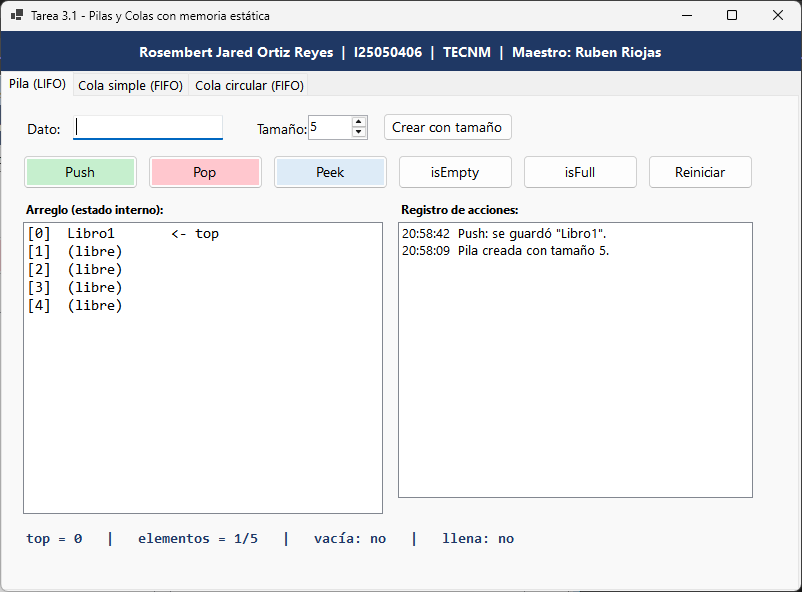
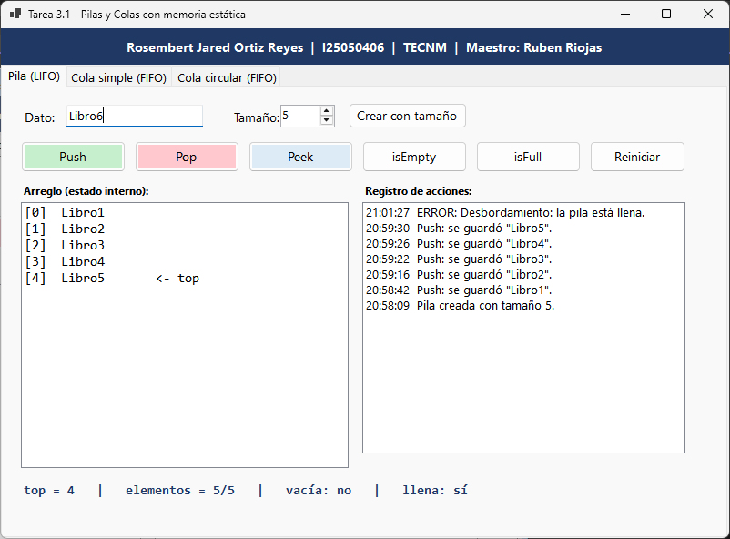
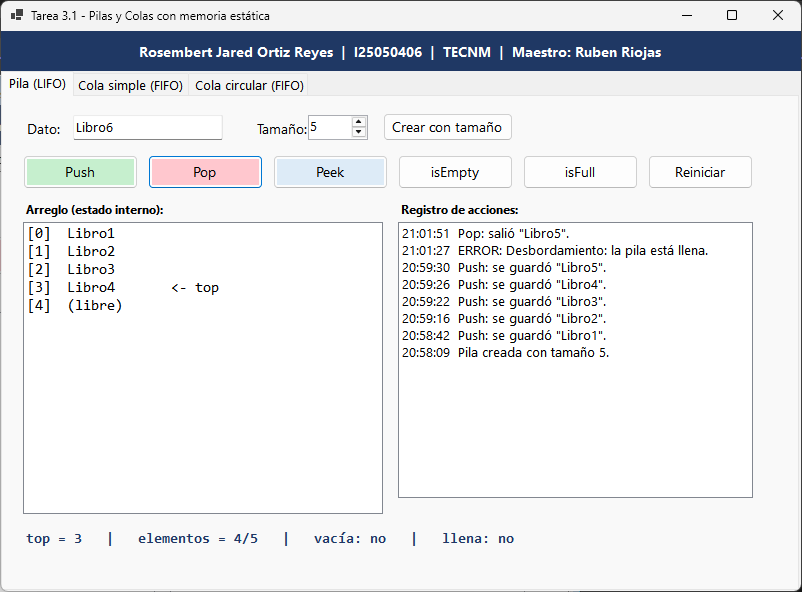
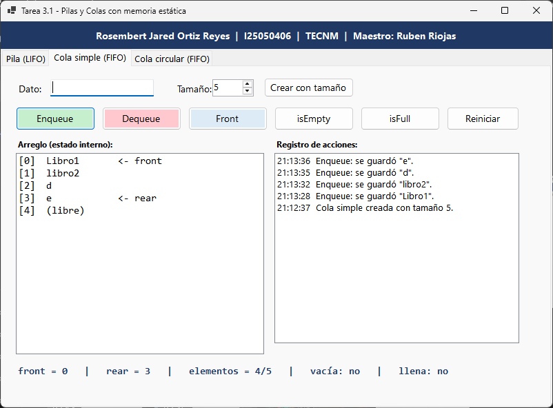
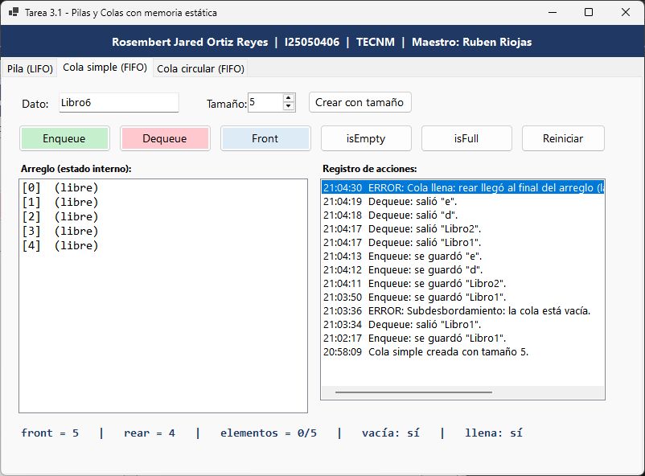
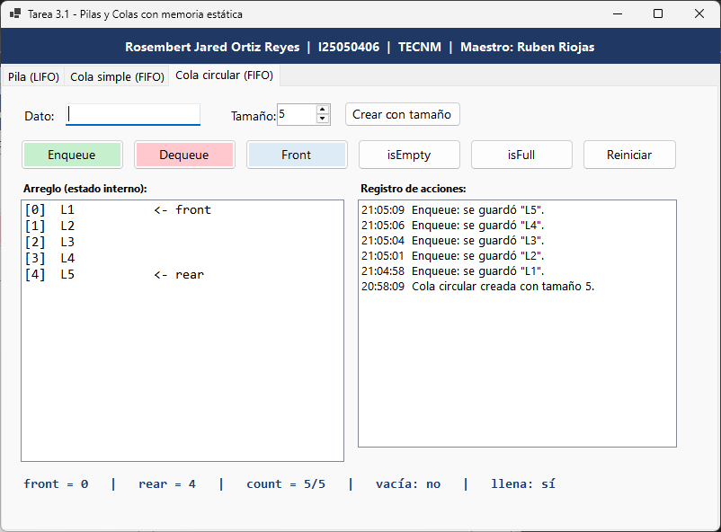
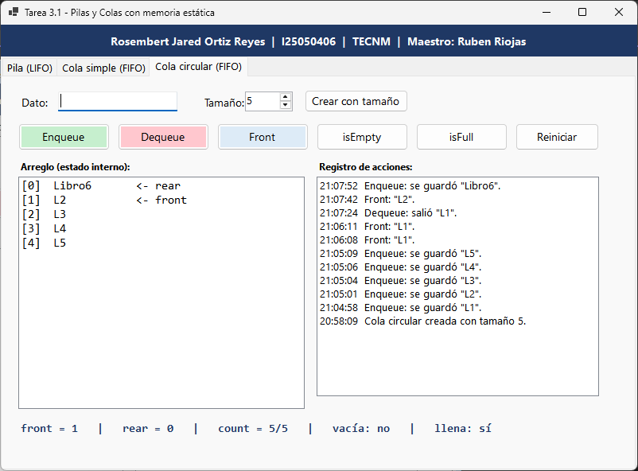

# Tarea 3.1 – Implementación estática de Pilas y Colas

**Alumno:** Rosembert Jared Ortiz Reyes
**Matrícula:** I25050406
**Escuela:** TECNM
**Maestro:** Ruben Riojas
**Fecha:** 2 de noviembre de 2026

## Descripción

Programa en C# (Windows Forms, .NET 8) que implementa desde cero una **Pila**, una **Cola simple** y una **Cola circular** usando **arreglos estáticos** y punteros de índice (`top`, `front`, `rear`), sin colecciones nativas (`List`, `Stack`, `Queue`).

| Estructura | Política | Punteros | Reutiliza espacio |
|---|---|---|---|
| Pila | LIFO | `top` | Sí |
| Cola simple | FIFO | `front`, `rear` | No |
| Cola circular | FIFO | `front`, `rear`, `count` | Sí |

Operaciones: Push/Enqueue, Pop/Dequeue, Peek/Front, isEmpty e isFull.

## Cómo ejecutar

1. Instalar Visual Studio 2022 (carga de trabajo "Desarrollo de escritorio con .NET") o el SDK de .NET 8 en Windows.
2. Abrir `PilasColas.csproj` (Visual Studio: Archivo > Abrir > Proyecto).
3. Presionar **F5** o ejecutar `dotnet run`.

## Cómo modificar el diseño

Abrir `Interfaz/MainForm.cs` o `Interfaz/PanelEstructura.cs` con doble clic en el Explorador de soluciones para abrir el **Diseñador** y editar los controles visualmente. Las tres pestañas usan el mismo `PanelEstructura`, así que un cambio ahí se aplica a las tres.

## Estructura del proyecto

```
PilasColas/
├── PilasColas.csproj
├── Program.cs
├── Estructuras/
│   ├── IEstructura.cs
│   ├── PilaEstatica.cs
│   ├── ColaSimple.cs
│   └── ColaCircular.cs
├── Interfaz/
│   ├── MainForm.cs / MainForm.Designer.cs
│   └── PanelEstructura.cs / PanelEstructura.Designer.cs
└── capturas/
```

Documentación detallada del código: [`DOCUMENTACION_CODIGO.md`](DOCUMENTACION_CODIGO.md).

## Capturas de prueba

> Guarda tus imágenes en la carpeta `capturas/` con estos nombres (o cambia los nombres aquí).

### Pila

**Datos insertados (Push)**



**Error de desbordamiento (pila llena)**



**Después de un Pop**



### Cola simple

**Datos encolados (Enqueue)**



**Error: rear al final aunque hay espacios libres**



### Cola circular

**Cola llena**



**Después de Dequeue y Enqueue (rear regresa al inicio)**



## Video en YouTube

Enlace público: *(pega aquí tu enlace)*
